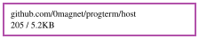

# progterm

A desktop terminal that is a **progressive terminal host**: your own shell, on
a real pty on this machine, drawn by [websh](https://github.com/0magnet/websh)'s
host in a browser app window.

Native programs run as they do in any terminal: vim, htop, ssh, git, whatever
your shell runs. A *progressive* terminal program, one that asks its terminal
what it offers ([websh's PROTOCOL.md](https://github.com/0magnet/websh/blob/main/PROTOCOL.md)),
gets more here than in a desktop terminal:
- **real pictures over its cells** (kitty's graphics protocol);
- **widgets it ships itself**: HTML or wasm, run in a sandboxed iframe, talking
  to the program both ways over its own output and input;
- **an accessible rendition** of what it shows, for screen readers;
- **sound, notifications, the clipboard and file drops.**

The same program, unchanged, falls back to cells in a terminal that offers none
of that.

```sh
make build        # builds the host page (wasm) and the binary that embeds it
./progterm        # opens a window with your shell
```

`websh/cmd/progdemo` built natively is the program to try in it: it shows each
capability beside what it does where a terminal cannot.

## How it works

`progterm` starts one HTTP server on a loopback address. It serves the host
page, which is websh's host built to wasm and embedded in the binary, and opens
it as an app window: a Chromium-family browser's `--app`, which has no address
bar or tabs. The page connects back over a WebSocket, and the bridge starts
your shell (`$SHELL -l`) on a pty for it. Binary messages carry the pty's bytes
both ways, and a text message carries the window's size. Each window is its own
shell, and the bridge exits when the last one does.

`TERM` is `xterm-256color` and `TERM_PROGRAM` is `progterm`.

## Safety

The window is a shell on your machine, so only the page progterm opened may
reach it:
- the server listens on loopback only, and refuses a non-loopback `--addr`;
- each launch makes a random 256-bit token, carried in the window's link
  *fragment*, which no HTTP request includes, and removed from the address
  once read;
- the pty endpoint requires the token and an `Origin` of the page's own;
- every request must name the server's own `Host`, which stops a page
  elsewhere from reaching it by pointing a DNS name at 127.0.0.1.

## Trust

The host cannot see whether the bytes on the pty are this machine's or those of
an ssh session running inside your shell. No desktop terminal can. So progterm's
output gets websh's **remote** rules, and programs are told so in their
`caps?` reply:
- it may not change the font or the page;
- a clipboard write or a file it offers asks you first;
- notifications are rate-limited.

It may set the window's title, as every desktop terminal lets output do. In
websh's terms this is the `terminal` source (PROTOCOL.md, Trust).

## Flags

| Flag | |
|---|---|
| `--shell` | the shell to run (default `$SHELL`, else `/bin/sh`); `--shell websh` runs [websh](https://github.com/0magnet/websh) itself on this machine |
| `--browser` | the browser to open the window with (default: the first of brave, chromium, google-chrome, microsoft-edge on `PATH`, else `xdg-open`) |
| `--no-open` | print the window's address instead of opening it |
| `--addr` | the loopback address to serve on (default `127.0.0.1:0`, any free port) |

## Without a browser: `progterm gio`

```bash
progterm gio                 # websh if installed, else $SHELL
progterm gio --shell bash --font-size 15
progterm gio --font "DejaVu Sans Mono 10"
progterm gio --in-process     # websh in this process, one per tab
```

The same shell on a pty, in a window [Gio](https://gioui.org) draws instead of a page: [xterm-go](https://github.com/0magnet/xterm-go)'s terminal core (`vt`) fed by the pty, its cells drawn into one image (braille drawn, since fonts often have none). It is the host for where no browser runs, a phone's app first: the terminal (`glterm`) knows nothing of Gio, which is only the window, input, clipboard and on-screen keyboard underneath (`gioterm`).

It draws cells only. A progressive program finds no host to ask and draws as in any terminal, and TUIs (`skywire cli visor hv tui`, live views) work as they do in one. Drag selects (double click a word, triple a line); right click opens Copy, Paste and Select All (Ctrl+Shift+C, V, A); middle click and Shift+Insert paste the last selection; the wheel and Shift+PageUp/Down scroll back. A program that asks for the mouse gets it; Shift takes it back for selecting. It needs cgo, and X11 or Wayland.

The font is `--font "Family Size"`, found with fontconfig (`fc-match`) in its regular, bold, italic and bold italic styles, a missing style drawn with the regular one. Without `--font` it is the desktop terminal's: xfce4-terminal's when it has its own, then GNOME's monospace font, then fontconfig's `monospace`. Go Mono is built in and is used where none of that works. The size is in points at the screen's DPI (`Xft.dpi` on X11), so 10 is the size it is in other terminals. The window opens 100 by 30 cells of that font, fewer where the screen has no room for them.

Shells open as tabs in one window, as in the browser desk. Ctrl+Shift+T or the `+` opens one, Ctrl+Shift+W or a middle click on its tab closes it, and a tab goes when its program exits; the window closes with the last. Click a tab, use Ctrl+Tab and Ctrl+Shift+Tab or Ctrl+PageDown and PageUp, or Alt+1 to Alt+9 to change tabs. A program embedding gioterm opens more at the start with `Options.Tabs`, each running its own command.

`progterm gio --in-process` runs websh in the window's own process, one per tab, each on a pty the process opens itself (`glterm.StartFunc`). It is the shape of an app with no shell binary to start, as on Android, where an app may open ptys but not run files it wrote. The kernel signals no one for Ctrl+C on such a pty, so the window reads the pty's settings and, while they say the kernel would (ISIG on, as while a command runs), passes Ctrl+C and Ctrl+\ to that tab's websh as signals (`console.Options.Signals`). At a prompt or in a full-screen program they stay keys.

## Status

Verified on Linux, in Brave:
- **a real shell on a pty:** `tty`, size changes, and `TERM_PROGRAM`;
- **window titles** from the shell;
- **the guards:** a wrong `Host` and a missing token are both refused;
- **the native `progdemo` running in it:** discovery reports the remote trust
  level; the picture is drawn sharply over its cells; and the shipped slider
  drives the program's cells.

Not yet:
- **Other platforms:** macOS (the pty library supports it, but it is untested)
  and Windows (no pty here; ConPTY would be needed).
- **Shipping the binary:** the host page is built locally by `make`, not
  committed, so `go install` alone does not give a working binary yet.

## License

MIT.

## Dependency Graph

Made with [goda](https://github.com/loov/goda):

```
# GOOS=js: the import edges of a wasm program live in js/wasm-tagged
# files and are invisible to a host-context run
GOOS=js GOARCH=wasm go run github.com/loov/goda@latest graph github.com/0magnet/progterm/... | dot -Tsvg -o docs/progterm-goda-graph.svg
```



## Lines of Code

Made with [gocloc](https://github.com/hhatto/gocloc) (excludes `vendor/`, `node_modules/`, `.git/`):

```
gocloc --not-match-d='(vendor|node_modules|\.git)' .
```

```
-------------------------------------------------------------------------------
Language                     files          blank        comment           code
-------------------------------------------------------------------------------
Go                               3             41             50            431
Makefile                         1             23             52            116
Markdown                         1             27              0             99
YAML                             1              0              7             98
Bourne Shell                     1              8             17             31
HTML                             1              0              0             21
-------------------------------------------------------------------------------
TOTAL                            8             99            126            796
-------------------------------------------------------------------------------
```
